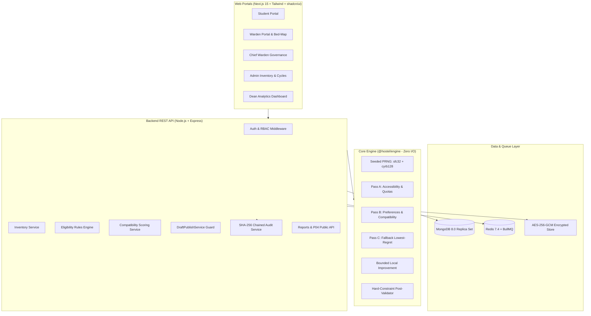

# Policy-Driven Hostel Allocation Engine with Roommate Compatibility Matching

A production-grade, deterministic university hostel allocation engine and residential management platform built with Next.js 15, Node.js/Express, TypeScript, and MongoDB.

---

## 1. System Architecture



---

## 2. Quickstart (&le; 5 Commands)

```bash
# 1. Install dependencies
pnpm install

# 2. Start database infrastructure (MongoDB Replica Set + Redis)
docker compose up -d

# 3. Seed deterministic campus inventory & synthetic applicants (~8,000 beds)
pnpm --filter @hostel/api seed

# 4. Run automated test suite & invariant property tests
pnpm test

# 5. Start development servers (API: :4000, Web: :3000)
pnpm dev
```

---

## 3. Core Invariants (Non-Negotiable)

- **I1 — Draft/Published Separation**: Strict state machine (`GENERATING` &rarr; `DRAFT` &rarr; `UNDER_REVIEW` &rarr; `APPROVED` &rarr; `PUBLISHED`). Exactly one code path sets `PUBLISHED`: `DraftPublishService.publish()`. Requires matching approval record hash, runs in a transaction, and writes an audit log entry.
- **I2 — Immutability After Publish**: Published drafts, assignments, and explanations cannot be modified or deleted.
- **I3 — Reproducibility**: Identical inputs snapshot + seed + parameters + engine version &rArr; byte-identical output draft.
- **I4 — Explainability**: Every assignment stores a structured explanation with preference rank satisfied, constraints checked, quota bucket, tiebreak value, compatibility score, and human-readable rationale.
- **I5 — Mandatory Override Reason**: Overrides require a non-empty reason (&ge;10 chars) and category. Hard-constraint overrides require Chief Warden escalation.
- **I6 — Sensitive Lifestyle Data**: Questionnaire answers encrypted at rest with AES-256-GCM. Never returned to students or staff. Aggregate pairwise scores only. Deletable on request with tombstone audit.
- **I7 — Audit Log**: Append-only, SHA-256 hash-chained log with tamper detection.
- **I8 — Zero Hard-Constraint Violations**: Gender blocks strictly segregated, accessible beds allocated to students requiring accessibility, room capacity strictly respected, zero double-assignments.

---

## 4. Portals & Workflows

| Portal | URL Route | Key Capabilities |
| :--- | :--- | :--- |
| **Student** | `/apply`, `/eligibility`, `/preferences`, `/questionnaire`, `/result` | Application submission, real-time eligibility evaluation with remedies, drag-and-drop preference ranking, encrypted roommate compatibility questionnaire, allotment letter PDF download, room-change requests. |
| **Warden** | `/bedmap` | Floor-by-floor visual bed map with status/accessibility colors, occupant inspection, reasoned manual overrides, waitlist auto-promotion, room-change decisions. |
| **Chief Warden** | `/escalations` | Cross-hostel governance, escalation queue for hard-constraint overrides, final publication sign-off. |
| **Admin** | `/inventory`, `/cycles`, `/runs`, `/verifications`, `/reports` | Bulk CSV inventory import with dry-run validation, cycle configuration, deterministic engine execution, document verification queue, CSV reporting. |
| **Dean** | `/analytics` | Institutional KPI cards, campus occupancy heatmap, preference satisfaction metrics, warden override audit breakdown. |

---

## 5. Performance Benchmark

The engine allocates **8,000 synthetic applicants** to **8,000 campus beds** across 5 hostels, 20 blocks, and 2,960 rooms in **3.52 to 4.99 seconds** (&sim;120x faster than the 10-minute requirement), with zero hard-constraint violations across 200+ property test iterations.

---

## 6. Documentation Index

- [`docs/ALGORITHM_SPEC.md`](./docs/ALGORITHM_SPEC.md) — Detailed algorithm specification and multi-pass heuristic design.
- [`docs/POLICY_TO_RULE_MAPPING.md`](./docs/POLICY_TO_RULE_MAPPING.md) — University policy to declarative rules engine mapping.
- [`docs/SECURITY.md`](./docs/SECURITY.md) — Security architecture, threat model, and OWASP Top 10 mitigations.
- [`docs/API.md`](./docs/API.md) — REST API endpoint reference and schemas.
- [`docs/USER_GUIDE.md`](./docs/USER_GUIDE.md) — Role-by-role operational guide.
- [`docs/TEST_REPORT.md`](./docs/TEST_REPORT.md) — Test verification report and property proofs.
- [`docs/DECISIONS.md`](./docs/DECISIONS.md) — Architectural Decision Records (ADRs).
- [`docs/PERFORMANCE.md`](./docs/PERFORMANCE.md) — Scalability benchmarks and profiling data.
