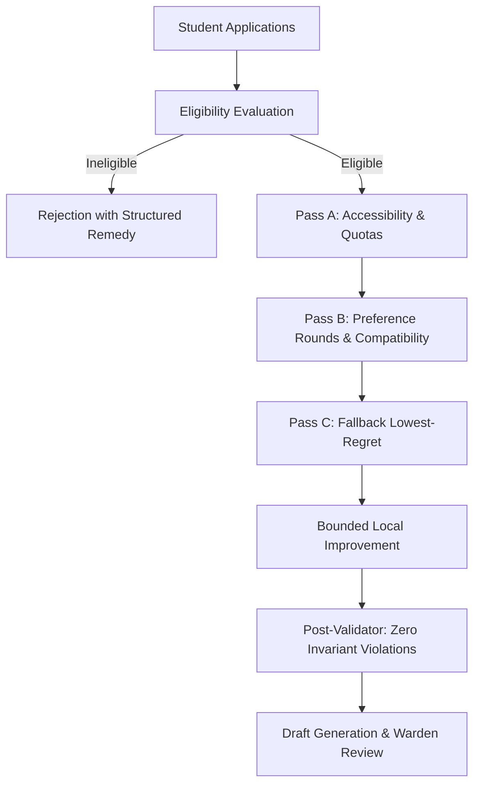

# University Residential Policy to Rules Engine Mapping

This document details how the institutional hostel allocation policies of the university are formally mapped to deterministic rules, mathematical formulas, and engine passes.

---

## 1. Policy Overview & Governance Hierarchy

The University Hostel Allocation Policy establishes a structured, transparent, and reproducible methodology for distributing limited on-campus accommodation among eligible students.

---

## 2. Eligibility Rules & Remediation

Eligibility is evaluated via a versioned, declarative rules engine before an application can participate in any allocation run.

| Rule ID | Policy Reference | Condition | Failure Reason | Remedy Instructions |
| :--- | :--- | :--- | :--- | :--- |
| `R-ACAD-01` | Acad. Reg. 4.2 | `academicYear >= 1` | "Must be an active student enrolled in an accredited program." | Contact the Academic Dean's office to resolve your registration status. |
| `R-DISC-02` | Disciplinary Code 12.1 | `disciplinaryFlags == 0` | "Active disciplinary suspension from university residences." | Submit an appeal to the Proctorial Board with supporting documents. |
| `R-FEE-03` | Fin. Ordinance 7.4 | `hasPaidDues == true` | "Outstanding tuition or hostel dues from prior semesters." | Clear outstanding balances on the student finance portal and re-check. |
| `R-DOCS-04` | Residence Guidelines 3.1 | `requiredDocsUploaded == true` | "Mandatory documents missing or rejected during verification." | Upload valid PDF proofs for all requested document categories. |

### Fix-and-Resubmit Flow:
When a student fails one or more rules, the API returns a structured report listing:
1. `failedRuleIds`: Array of specific rule identifiers.
2. `reasons`: Human-readable explanations of each failure.
3. `remedyInstructions`: Actionable guidance for rectifying each deficiency.
Once the student uploads the missing document or clears their dues, the application can be re-evaluated and marked `ELIGIBLE`.

---

## 3. Priority Ordering & Deterministic Tie-Breaking

Eligible applicants are prioritized using a multi-tier composite ordering:

$$P = \langle \text{Priority Tier}, \text{Academic Seniority (Year)}, \text{Merit Rank (CGPA / Entrance)}, \text{Distance from Campus}, \text{Seeded PRNG Tiebreak} \rangle$$

### 3.1 Priority Tiers
1. **Tier 1 — Persons with Disabilities (PWD)**: Mandated immediate ground-floor / accessible allocation.
2. **Tier 2 — Reserved Categories**: Affirmative action quotas (SC, ST, OBC-NCL, EWS) allocated up to mandated statutory percentages.
3. **Tier 3 — International Students**: Guaranteed accommodation for international students without domestic family residences.
4. **Tier 4 — Senior Undergraduates & Postgraduates**: Final-year students completing capstone projects and thesis dissertations.
5. **Tier 5 — General Merit Applicants**: All other eligible students ordered by distance from campus and academic merit.

### 3.2 Deterministic Tie-Breaking
When applicants have identical composite scores, tiebreaking is performed using a seeded pseudo-random value:
$$\text{Tiebreak Value} = \text{PRNG}(\text{seed} \parallel \text{cycleId} \parallel \text{studentId})$$
This guarantees that tiebreaking is 100% fair, non-manipulable, and completely reproducible across subsequent runs.

---

## 4. Multi-Pass Heuristic Engine Specification

### Pass A: Accessibility & Quotas
- **Accessibility Guarantee**: Students with documented physical disabilities are matched exclusively to certified accessible beds (`isAccessible: true`), primarily on ground floors or in elevators-serviced blocks.
- **Quota Fulfillment**: Fills reserved category quotas from dedicated hostel wings according to institutional policy.

### Pass B: Ranked Preferences & Roommate Compatibility
- **Preference Matching**: Evaluates up to $k$ ranked preferences per student (Hostel, Room Type).
- **Roommate Co-Assignment**: If students mutually request each other as roommates:
  - Both students must be eligible for the same hostel and gender block.
  - The engine attempts to allocate them together in a double, triple, or quad room.
- **Compatibility Scoring (for unlinked roommates)**:
  When pairing students without mutual requests, the engine calculates a weighted pairwise compatibility score:
  $$\text{Score}(A, B) = \sum_{i=1}^{n} w_i \cdot \text{Sim}(A_i, B_i)$$
  Attributes evaluated include:
  - Sleep schedule & bedtime alignment ($w_1 = 0.25$)
  - Study environment preference (quiet vs music, $w_2 = 0.20$)
  - Cleanliness & room maintenance standards ($w_3 = 0.20$)
  - Dietary preference & habits ($w_4 = 0.15$)
  - Social & guest visitation habits ($w_5 = 0.20$)

### Pass C: Fallback Lowest-Regret Assignment
- Applicants whose preferences could not be satisfied due to capacity constraints are assigned to remaining available beds that minimize regret (distance from first-choice hostel and room type).
- If all compatible hostel capacity is exhausted, applicants are placed on an ordered **Waiting List** with a documented reason (`HOSTEL_CAPACITY_EXHAUSTED` or `ACCESSIBLE_CAPACITY_EXHAUSTED`).

---

## 5. Post-Allocation Invariant Enforcement

Before any draft is saved to the database, the **Post-Validator** re-checks 100% of assignments against all hard constraints:
1. **Single Assignment**: No student is assigned to more than one bed.
2. **Single Occupant**: No bed is assigned to more than one student.
3. **Room Capacity**: The number of assigned beds in a room cannot exceed the room's certified physical capacity.
4. **Gender Block Integrity**: Male students are never assigned to female blocks or vice-versa.
5. **Accessibility Match**: Students requiring accessible accommodations are never placed in non-accessible beds.
6. **Conservation**: Total assigned students + total waiting list students = total eligible applicants.
